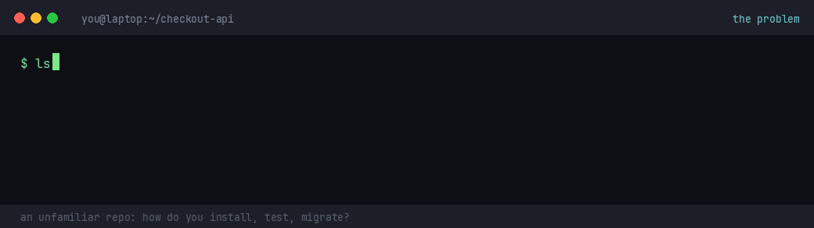

# repo-runbook

<h3 align="center">Write down how to build, test and migrate a repo — once — so no session rediscovers it.</h3>

<p align="center">
  <a href="LICENSE"></a>
  
  
  
</p>

<p align="center">
  
</p>

## What it is

`repo-runbook` **generates and maintains a short runbook** for a repository, and stores it in
`AGENTS.md` (or `CLAUDE.md`) where every future session reads it at startup. It detects the stack from
manifests — package manager, test runner, linter, dev server, migration tool, services in the compose
file, env keys, CI workflows — and writes a 20-line block between markers, with a `check` mode that
reports drift when the repo changes.

## The problem it removes

Every fresh session in a repo you have worked in before spends its first forty tool calls
grepping for the test command. In the session logs this came from, that pattern appeared **16,315
times**. A runbook turns that into twelve lines read once.

## Install

```bash
# Claude Code — the whole collection as one marketplace
claude plugin marketplace add Appit-labs/appit-skills
claude plugin install repo-runbook@appit-skills

# pi
pi install git:github.com/Appit-labs/repo-runbook

# any agent that reads a skills directory
git clone git@github.com:Appit-labs/repo-runbook.git
cp -r repo-runbook/skills/repo-runbook ~/.claude/skills/      # or ~/.codex/skills/, .cursor/skills/, …
```

## Use

- **Propose** — `scripts/runbook.py scan /path/to/repo` — prints the block, writes nothing
- **Write** — `scripts/runbook.py write /path/to/repo`
- **Check for drift** — `scripts/runbook.py check /path/to/repo` — exit 1 when manifests changed
- **Machine-readable** — `--json`

## What it does not do

- It does not crawl your source. Manifest facts only, so commands it cannot see are left to you.
- It does not run the commands it writes — you verify the test command, dev port and migration direction.

## Requires

- Python 3.9+ (stdlib only).
- A git repo, or a folder of repos.
- `AGENTS.md` / `CLAUDE.md` is created if missing.

## Cost

| | tokens |
| --- | --- |
| always-on — the description, paid every session | ~87 |
| on invoke | ~0.9k |

The demo above is not a mockup: `demos/repo-runbook.json` holds the captured run and
`tools/make_demo.py` renders it, so it can be regenerated and audited.

## Security

SkillSpector: **0/100, SAFE, 0 open findings** against the committed baseline. Every accepted
finding is listed with its reason in [SECURITY.md](SECURITY.md). No `shell=True`, no credential
storage, no network destination chosen at runtime.

## Part of the Appit collection

[appit-skills](https://github.com/Appit-labs/appit-skills) — browser QA · CI triage · Postgres · runbooks ·
SSH · Trello · cloud browsers · OpenDesign · Blender.

## License

MIT, copyright Appit Labs. See [LICENSE](LICENSE).
